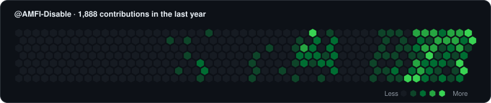

# AMFI-Disable

Welcome! I am a software engineer focused on native macOS desktop applications, high-performance systems utilities, terminal environments, and browser automation. I build local-first, highly responsive software with clean user interfaces and robust architectures.

---

## GitHub Star History & Activity

<!-- public-star-history:start -->
 

**113 public stars** across 21 repositories. AMFI-Disable has 96 and BigBrainDevBros has 17. Snapshot from 2026-11-26 UTC.

### Combined Star History

<a href="https://www.star-history.com/?type=date&amp;repos=AMFI-Disable%2FAMFI-Disable%2CAMFI-Disable%2FAMFI-Disable.github.io%2CAMFI-Disable%2FBrew-Ghost%2CAMFI-Disable%2FBrewStore%2CAMFI-Disable%2FFMG_Free-MapGenie%2CAMFI-Disable%2FGeoFS_Extension%2CAMFI-Disable%2FGeoFS_LiverySelector%2CAMFI-Disable%2FGimSell_Gimkit-Seller%2CAMFI-Disable%2FHomebrew-BrewStore%2CAMFI-Disable%2FHomebrew-Juicer%2CAMFI-Disable%2FHomebrew-Tap%2CAMFI-Disable%2FJuicer%2CAMFI-Disable%2FLichess-AutoPlayer%2CAMFI-Disable%2FOmniSuite%2CAMFI-Disable%2FPathDeck%2CAMFI-Disable%2FTornTools%2CBigBrainDevBros%2F.github%2CBigBrainDevBros%2FFaceOff%2CBigBrainDevBros%2FIGPirate%2CBigBrainDevBros%2FRenYing%2CBigBrainDevBros%2FVANTAGE">
  <picture>
    <source media="(prefers-color-scheme: dark)" srcset="https://api.star-history.com/chart?repos=AMFI-Disable%2FAMFI-Disable%2CAMFI-Disable%2FAMFI-Disable.github.io%2CAMFI-Disable%2FBrew-Ghost%2CAMFI-Disable%2FBrewStore%2CAMFI-Disable%2FFMG_Free-MapGenie%2CAMFI-Disable%2FGeoFS_Extension%2CAMFI-Disable%2FGeoFS_LiverySelector%2CAMFI-Disable%2FGimSell_Gimkit-Seller%2CAMFI-Disable%2FHomebrew-BrewStore%2CAMFI-Disable%2FHomebrew-Juicer%2CAMFI-Disable%2FHomebrew-Tap%2CAMFI-Disable%2FJuicer%2CAMFI-Disable%2FLichess-AutoPlayer%2CAMFI-Disable%2FOmniSuite%2CAMFI-Disable%2FPathDeck%2CAMFI-Disable%2FTornTools%2CBigBrainDevBros%2F.github%2CBigBrainDevBros%2FFaceOff%2CBigBrainDevBros%2FIGPirate%2CBigBrainDevBros%2FRenYing%2CBigBrainDevBros%2FVANTAGE&amp;type=date&amp;theme=dark&amp;legend=top-left" />
    
  </picture>
</a>
<!-- public-star-history:end -->

### Contribution Hexagon Graph

<picture>
  <source media="(prefers-color-scheme: dark)" srcset="https://raw.githubusercontent.com/AMFI-Disable/AMFI-Disable/main/assets/contribution-hexagon-dark.svg" />
  <source media="(prefers-color-scheme: light)" srcset="https://raw.githubusercontent.com/AMFI-Disable/AMFI-Disable/main/assets/contribution-hexagon-light.svg" />
  
</picture>

---

## [AMFI Studio](https://amfi-disable.github.io/#studio) — macOS Native Apps

### [BrewStore](https://github.com/AMFI-Disable/BrewStore)

*A focused, native macOS graphical package manager for Homebrew.*

- Streamlines discovering, installing, updating, and safely removing CLI formulas, desktop casks, and background services.
- Features integrated diagnostic auditing, background service controls, and companion CLI helpers.
- Available via [Homebrew-Tap](https://github.com/AMFI-Disable/Homebrew-Tap) (`brew install --cask AMFI-Disable/tap/brewstore`) · [Project Site](https://amfi-disable.github.io/BrewStore/).

### [Juicer](https://github.com/AMFI-Disable/Juicer)

*A comprehensive, 100% free and open-source local-first desktop system utility for macOS power users and developers.*

- Consolidates app uninstallers, orphan file cleaners, launchd/service managers, developer cache pruners, hidden system tweakers, Gatekeeper tools, DNS editor, and LaunchServices overrides.
- Built natively with **SwiftUI** featuring a modular, local-first systems architecture.
- Available via [Homebrew-Tap](https://github.com/AMFI-Disable/Homebrew-Tap) (`brew install --cask AMFI-Disable/tap/juicer`) · [Project Site](https://amfi-disable.github.io/Juicer/).

### [PathDeck](https://github.com/AMFI-Disable/PathDeck)

*A sleek, native macOS utility built in SwiftUI to inspect and organize shell configuration environments.*

- Visually manages, validates, reorders, and safely creates backups of system paths (`$PATH`), shell aliases, and environment variables.
- [Project Site](https://amfi-disable.github.io/PathDeck/).

---

## [AMFI Terminal](https://amfi-disable.github.io/#terminal) — CLI & Developer Tools

### [OmniSuite](https://github.com/AMFI-Disable/OmniSuite)

*A command-line and terminal user interface workstation engineered for forensic research and debate case compilation.*

- **OmniDebate**: High-efficiency research and evidence management terminal app built in Python using **Textual**.
- **OmniFormat**: Automated brief compiling and document formatting processor.
- **Architecture**: Backed centrally by SQLite with SQLAlchemy ORM and Alembic schema migrations · [Project Site](https://amfi-disable.github.io/OmniSuite/).

### [Brew-Ghost](https://github.com/AMFI-Disable/Brew-Ghost)

*A behavioral cleanup utility for Homebrew package management.*

- Analyzes local shell history to detect unreferenced and inactive 'ghost' packages, recommending safe removals.
- Available via [Homebrew-Tap](https://github.com/AMFI-Disable/Homebrew-Tap) (`brew tap AMFI-Disable/tap`) · [Project Site](https://amfi-disable.github.io/Brew-Ghost/).

---

## [AMFI Hangar](https://amfi-disable.github.io/#hangar) — Browser Extensions & Userscripts

### [GeoFS_Extension](https://github.com/AMFI-Disable/GeoFS_Extension)

*An all-in-one Manifest V3 Chrome extension and flight deck companion for GeoFS V3.9 and V4.0.*

- Consolidates avionics HUDs, autothrottle, realism physics, fuel management, landing statistics, failure simulation, and checklists into a single conflict-free extension.
- Built with TypeScript and Vite, featuring Day/Night cockpit theming and live module toggles · [Project Site](https://amfi-disable.github.io/GeoFS_Extension/).

### [Lichess-AutoPlayer](https://github.com/AMFI-Disable/Lichess-AutoPlayer)

Practice premoves against a local computer opponent.

- Queue a move during the reply, cancel it, or reset the board. [Open Premove Practice](https://amfi-disable.github.io/Lichess-AutoPlayer/practice.html).

### [GimSell_Gimkit-Seller](https://github.com/AMFI-Disable/GimSell_Gimkit-Seller)

*A duplicate cosmetic inventory preview for the Gimkit Locker.*

- Features a compact, collapsible floating widget for fast client-side inventory management · [Project Site](https://amfi-disable.github.io/GimSell_Gimkit-Seller/).

---

## [AMFI Arcade](https://amfi-disable.github.io/#arcade) — Browser Games

### [RenYing](https://github.com/BigBrainDevBros/RenYing)

*A fast-paced, ink-wash martial-arts duel game built with HTML5 Canvas and WebRTC.*

- Delivers responsive combat mechanics, precision parry timings, and ink-wash visual aesthetics.
- Supports peer-to-peer WebRTC room matchmaking, local LAN multiplayer server, and offline standalone play.
- Maintained under [BigBrainDevBros](https://github.com/BigBrainDevBros) · [Play Online](https://bigbraindevbros.github.io/RenYing/).

### [FaceOff](https://github.com/BigBrainDevBros/FaceOff)

Choose an arena and a bot difficulty for a first-to-nine duel. In each 50-second round, the final 20 seconds reveal player positions. [Play FaceOff](https://bigbraindevbros.github.io/FaceOff/)

### [VANTAGE](https://github.com/BigBrainDevBros/VANTAGE)

HilbertQiu’s standalone browser shooter lets players choose a map and city size for a solo match with bots. [Play VANTAGE](https://bigbraindevbros.github.io/VANTAGE/)

---

## Official Homebrew Taps

- **[Homebrew-BrewStore](https://github.com/AMFI-Disable/Homebrew-BrewStore)**: Archived predecessor of the central tap.
- **[Homebrew-Tap](https://github.com/AMFI-Disable/Homebrew-Tap)**: Current distribution for Studio casks and terminal utilities.
- **[Homebrew-Juicer](https://github.com/AMFI-Disable/Homebrew-Juicer)**: Archived predecessor of the central tap.

---

## Technical Skills And Technologies

| Category | Technologies |
| :--- | :--- |
| **Languages** | Swift, Python, JavaScript (ES6+), TypeScript, Shell (Bash / Zsh), HTML5, CSS3 |
| **macOS & Desktop** | SwiftUI, AppKit, Combine, Foundation, Xcode, XcodeGen |
| **CLI & Terminal** | Textual, Rich, Click, Argparse, Shell Scripting |
| **Web & Automation** | Chrome Extensions API, Userscripts (Tampermonkey), Node.js, Cloudflare Workers |
| **Data & Storage** | SQLite, SQLAlchemy, Alembic, JSON Schema |
| **DevOps & Tooling** | Git, GitHub Actions CI/CD, Homebrew Packaging |

---

## Core Engineering Principles

- **Local-First Privacy**: Absolute privacy with zero telemetry, zero tracker dependencies, and complete client-side data ownership.
- **Native Desktop Performance**: Native SwiftUI and AppKit implementations designed to feel integrated into the macOS operating system.
- **Clean Code & Test Integrity**: Consistent architecture, automated CI validation, and clear documentation across all open-source projects.
